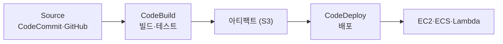

- 코드 변경을 빌드·테스트·배포까지 자동으로 이어주는 AWS CI/CD 서비스 묶음
- 역할: **CodeBuild**(빌드·테스트), **CodeDeploy**(배포), **CodePipeline**(단계 연결)

---

## 1. 동작 흐름

예: FastAPI 서비스 코드를 `main` 브랜치에 push한 상황

1. CodePipeline Source 단계가 GitHub 연결로 변경 감지 → 소스를 S3 아티팩트 버킷에 저장
2. CodeBuild가 `buildspec.yml` 실행: `pytest` → `docker build` → ECR push → `imagedefinitions.json` 출력
3. Deploy 단계가 새 이미지로 ECS 서비스 업데이트
4. CodeDeploy 블루그린이면 CloudWatch 알람 실패 시 이전 태스크 세트로 자동 롤백

---

## 2. 구성



- **CodePipeline**이 이 단계들을 순서대로 묶어 자동 실행
- 푸시 → Source 단계 트리거 → Build → Deploy 자동 진행

---

## 3. CodeBuild

- `buildspec.yml`에 빌드 단계 정의

```yaml
version: 0.2
phases:
  install:
    runtime-versions:
      python: 3.12
  build:
    commands:
      - pip install -r requirements.txt
      - pytest
      - docker build -t $REPO_URI:$TAG .
      - docker push $REPO_URI:$TAG
artifacts:
  files:
    - imagedefinitions.json
```

- 테스트 통과 → 이미지 빌드 → ECR 푸시 → 다음 단계로 아티팩트 전달

---

## 4. CodeDeploy

- 빌드된 산출물을 대상에 배포 + **배포 전략** 적용
- [Deployment Strategies](/aws/automation/deployment-strategies)의 롤링·블루그린·카나리와 연계

| 대상 | 배포 방식 |
|------|------|
| **EC2/온프레미스** | 인플레이스 / 블루그린 (Agent 기반) |
| **ECS** | 롤링 / 블루그린 (CodeDeploy + ALB) |
| **Lambda** | 카나리 / 선형(가중치 점진 이동) |

<Note type="success" title="자동 롤백">
- 배포 후 헬스체크·CloudWatch 알람 실패 → **자동 롤백**
- 안전한 무중단 배포의 핵심
</Note>

---

## 5. AWS CodePipeline vs GitHub Actions

<Compare>
<CompareCol title="CodePipeline" subtitle="AWS 네이티브" color="sky">
- AWS 서비스와 깊은 통합
- IAM 권한으로 안전한 배포
- AWS 안에서 완결
</CompareCol>
<CompareCol title="GitHub Actions" subtitle="범용 CI/CD" color="violet">
- 코드와 같은 곳(GitHub)
- 생태계·마켓플레이스 풍부
- OIDC로 AWS 키리스 배포
</CompareCol>
</Compare>

<Note type="pink" title="실무 정리">
- AWS 중심·규정 엄격 → CodePipeline
- GitHub 중심·범용 → GitHub Actions + [OIDC](/aws/iam/sts)로 AWS 배포
- 공통: 테스트 통과 게이트 + 헬스체크 기반 **자동 롤백**
- 컨테이너 → 빌드→ECR→ECS 배포가 표준 ([ECS](/aws/compute/ecs))
- 시크릿 → 코드에 넣지 않고 Secrets Manager/SSM Parameter Store
</Note>
