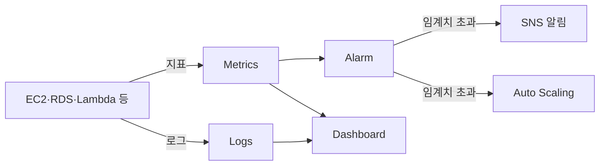
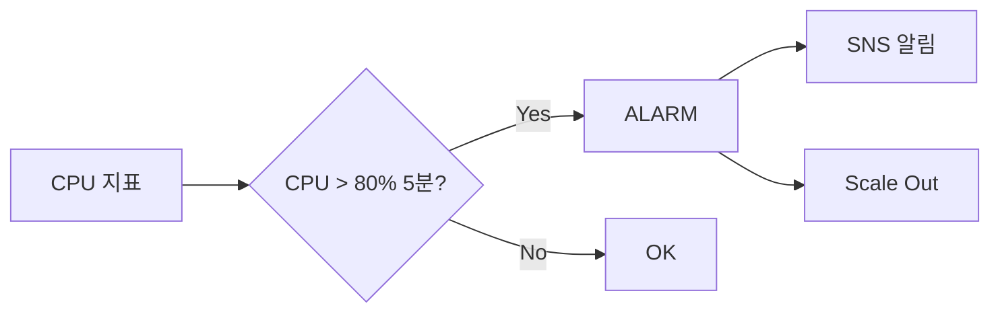

- AWS 리소스와 앱의 지표·로그를 모으고, 임계치를 넘으면 알림을 보내는 서비스
- 구성: **지표**(Metrics), **로그**(Logs), **알람**(Alarms)

---

## 1. 동작 흐름

예: checkout 서버 CPU가 치솟는 상황

1. EC2가 CPU 지표를 CloudWatch로 전송 (기본 5분, 상세 모니터링 켜면 1분)
2. 알람 조건 "평균 80% 초과, 5분 × 2회" 충족 → `ALARM` 상태
3. SNS로 Slack 알림 + Auto Scaling이 인스턴스 추가
4. 원인은 Logs Insights에서 `/ecs/checkout` 에러 로그 검색으로 확인

---

## 2. 구성



---

## 3. 지표 (Metrics)

- **네임스페이스** → 지표 묶음 (`AWS/EC2`, `AWS/RDS`)
- **디멘션** → 지표를 구분하는 키 (예: `InstanceId=i-0abc`)
- **기간(Period)** + **통계**(Average·Sum·Max…)로 조회
- 기본 지표(EC2 CPU 등) + **커스텀 메트릭**(앱이 직접 전송)

커스텀 메트릭 전송 예 (CLI):

```bash
aws cloudwatch put-metric-data \
  --namespace "MyApp" \
  --metric-name "OrdersCreated" \
  --value 1 \
  --dimensions Service=checkout
```

<Note type="note" title="커스텀 메트릭 활용">
- "주문 수", "결제 실패율" 같은 **비즈니스 지표**도 메트릭으로
- → 그 위에 알람·대시보드 구성 가능
</Note>

---

## 4. 로그 (Logs)

- **Log Group** → 로그 묶음 (예: `/ecs/checkout`)
- **Log Stream** → 그 안의 개별 로그 흐름 (인스턴스·컨테이너별)
- EC2 → **CloudWatch Agent** 설치해 로그 전송 / Lambda·ECS → 자동 연동
- **Logs Insights** → 로그를 SQL 비슷한 쿼리로 분석

Logs Insights 쿼리 예 (최근 에러 로그 20건):

```sql
fields @timestamp, @message
| filter @message like /ERROR/
| sort @timestamp desc
| limit 20
```

---

## 5. 알람 (Alarms)

- 메트릭이 **임계치**를 넘으면 → 알림·액션
- 상태 3가지: **OK** · **ALARM** · **INSUFFICIENT_DATA**(데이터 부족)
- 액션 → SNS(이메일·Slack) · Auto Scaling · EC2 재시작



알람 생성 예 (CLI):

```bash
aws cloudwatch put-metric-alarm \
  --alarm-name "high-cpu" \
  --namespace "AWS/EC2" --metric-name "CPUUtilization" \
  --dimensions Name=InstanceId,Value=i-0abc \
  --statistic Average --period 300 --evaluation-periods 2 \
  --threshold 80 --comparison-operator GreaterThanThreshold \
  --alarm-actions arn:aws:sns:ap-northeast-2:111111111111:ops-alerts
```

<Note type="warning" title="알람 설계 주의">
- **evaluation-periods** → 일시적 스파이크에 안 울리게 (예: 5분 × 2회 연속)
- 너무 민감 → 알람 피로(alert fatigue) · 너무 둔감 → 장애 놓침
</Note>

---

## 6. 대시보드

- **Dashboard** → 핵심 지표·로그·알람을 한 화면에 → 운영 상황판

<Note type="pink" title="실무 정리">
- 기본 지표 + **커스텀 메트릭**(비즈니스 지표)로 관측 범위 확장
- 로그는 Log Group 단위 정리 + **Logs Insights**로 분석
- 알람 → SNS로 Slack/이메일, [Auto Scaling](/aws/compute/autoscaling) 트리거
- evaluation-periods로 노이즈 억제
- 분산 추적(요청 흐름)은 CloudWatch만으론 부족 → X-Ray 병행
- 비용 → 커스텀 메트릭·로그 보존 기간이 길면 요금 증가 (로그 그룹별 보존 기간 설정)
</Note>
