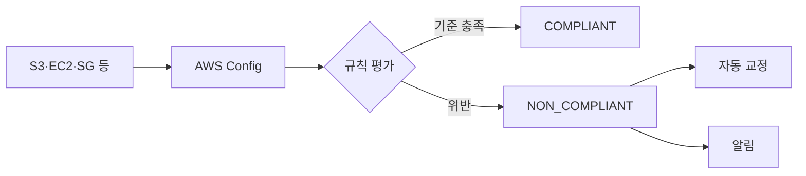

- 리소스 설정의 현재 상태와 변경 이력을 기록하고, 규칙으로 규정 준수 여부를 평가하는 서비스
- CloudTrail이 API 행위를 남긴다면, Config는 그 결과로 바뀐 리소스 구성 상태를 남김

---

## 1. 구성

| 구성 요소 | 하는 일 | 예 |
|------|------|------|
| **구성 레코더** | 기록할 리소스 유형 선택·기록 | `AWS::S3::Bucket`, `AWS::EC2::SecurityGroup` |
| **구성 항목(CI)** | 리소스 설정 스냅샷, 바뀔 때마다 새로 기록 | SG 인바운드 규칙 변경 전후 비교 |
| **전송 채널** | 스냅샷·이력 파일 저장 위치 | S3 버킷, SNS 토픽 |
| **Config Rules** | 설정 기준 충족 여부 평가 | `restricted-ssh` → `NON_COMPLIANT` |
| **자동 교정** | 위반 리소스를 SSM Automation으로 수정 | `AWS-DisableS3BucketPublicReadWrite` |
| **Aggregator** | 여러 계정·리전 결과 집계 | 조직 전체 준수 현황 한 화면 |

---

## 2. CloudTrail vs Config

| | CloudTrail | Config |
|--|-----------|--------|
| 추적 대상 | **API 호출**(행위) | **리소스 구성**(상태) |
| 질문 | 누가 무엇을 했나 | 지금 설정이 어떤가·맞나 |
| 예 | "누가 SG 수정함" | "공개된 S3 버킷이 있나" |

<Note type="note" title="상호 보완">
- CloudTrail → 행위 추적 / Config → 상태·준수 평가
- 보통 **함께** 사용 (행위 + 결과 상태)
</Note>

---

## 3. Config Rules

- 리소스가 **원하는 설정 기준**을 만족하는지 자동 평가 → `COMPLIANT` / `NON_COMPLIANT`
- AWS 관리형 규칙(수백 개) + 커스텀(Lambda) 규칙



대표 관리형 규칙 예:
- `s3-bucket-public-read-prohibited` → 공개 읽기 버킷 금지
- `encrypted-volumes` → EBS 암호화 필수
- `restricted-ssh` → SSH(22) 전체 개방 금지

---

## 4. 자동 교정 (Remediation)

- 위반 발견 → **자동으로 수정** (SSM Automation 연동)

예시 시나리오:

```
규칙: s3-bucket-public-read-prohibited
위반: prod-logs 버킷이 퍼블릭
교정: 자동으로 Block Public Access 적용 → COMPLIANT 복귀
```

<Note type="success" title="Conformance Pack">
- 여러 규칙을 **묶음(팩)** 으로 한 번에 배포
- 예: "CIS 벤치마크 팩", "PCI-DSS 팩" → 규정 세트 일괄 적용
</Note>

---

## 5. Audit Manager & 실무 Tip

- **Audit Manager** → 감사 프레임워크(SOC2·ISO 등) 기준으로 **증거 자동 수집·리포트**

<Note type="pink" title="정리">
- 구성 드리프트·규정 준수 → **AWS Config**(상태) + CloudTrail(행위) 조합
- 위험 설정(공개 버킷·SG 개방·미암호화) → 관리형 규칙으로 자동 탐지
- 위반 → **자동 교정**으로 셀프 힐링
- 다계정 → Config Aggregator로 전 계정 준수 현황 통합
- 감사 대응 → Audit Manager로 증거 수집 자동화
</Note>
